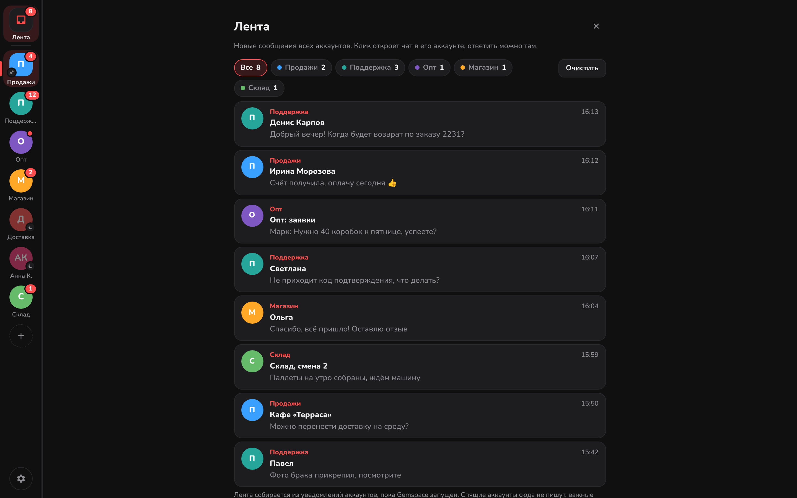
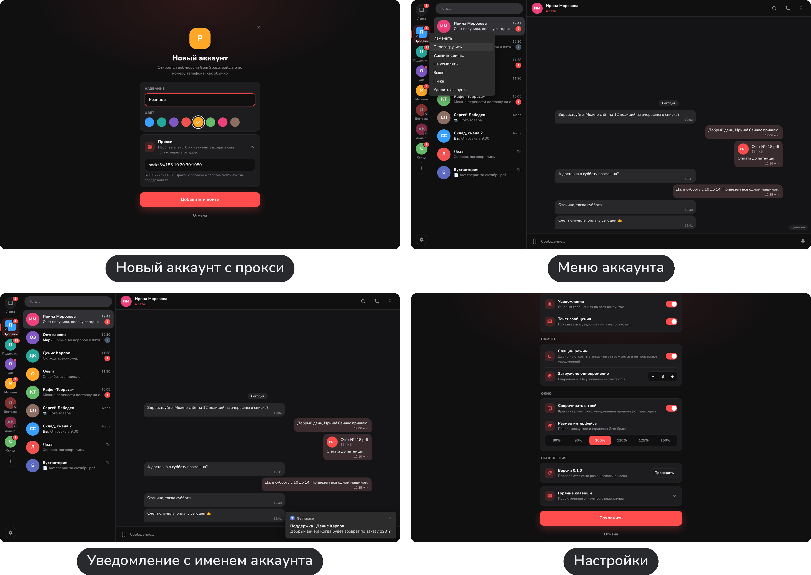
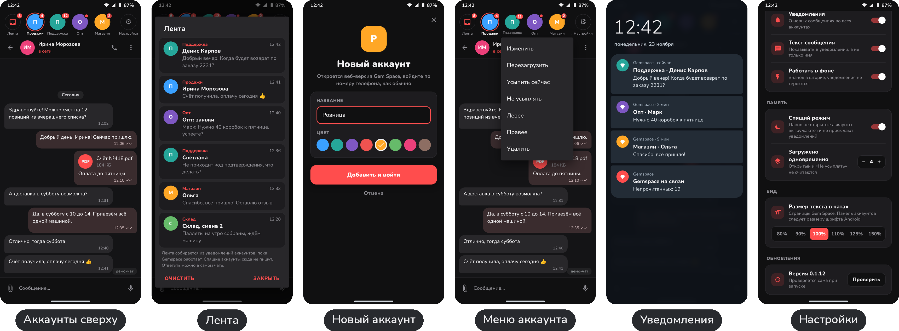

<h1 align="center">Gemspace</h1>

<b>Все ваши аккаунты Gem Space в одном окне.</b> 
5, 10, 30 аккаунтов на Windows и Android: рейл аккаунтов, счётчики, уведомления с именем аккаунта, свой прокси на каждый и спящий режим.

<a href="#скачать"><b>Скачать: Windows, Android</b></a>

## Скачать

| | Что | Файл |
|---|---|---|
| **Windows** | Windows 10/11 | [Gemspace-setup.exe](https://github.com/chvdbhcx-del/gemspaceallinone/releases/latest/download/Gemspace-setup.exe) |
| **Android** | Android 8+ | [Gemspace.apk](https://github.com/chvdbhcx-del/gemspaceallinone/releases/latest/download/Gemspace.apk) |

Ссылки всегда ведут на самую свежую сборку. Все сборки: [релизы](https://github.com/chvdbhcx-del/gemspaceallinone/releases).

- **Windows:** если SmartScreen ругается, нажмите «Подробнее» → «Выполнить в любом случае». Установка в папку пользователя, права администратора не нужны.
- **Android:** разрешите установку из неизвестных источников. Для нескольких аккаунтов нужен Android System WebView версии 128 или новее, он обновляется в Google Play. На старом WebView работает один аккаунт.

Скриншоты в демо-режиме, аккаунты и переписка выдуманные. Справа вместо Gem Space показан условный демо-чат: в приложении на этом месте открывается настоящая веб-версия Gem Space. ПК: окно 1440×900. Телефон: экран 390×844. Снимает их `node docs/make-screens.js`, сетки собирает `python3 docs/make-grids.py`.

## Кому это нужно

Тем, кто ведёт несколько аккаунтов Gem Space сразу: продажи и поддержка, магазины, агентства, менеджеры сообществ. Вместо нескольких браузеров, телефонов и постоянных выходов и входов одно приложение, где все аккаунты рядом и каждый уже залогинен.

Внутри открывается обычная веб-версия Gem Space, [web.gemspace.com](https://web.gemspace.com/), со всеми её чатами, файлами и звонками. Gemspace её не изменяет и не разбирает: он держит несколько её копий рядом, у каждой своё отдельное хранилище.

## Мультиаккаунт: как это работает

### Рейл аккаунтов

Слева полоса со всеми аккаунтами (на Android сверху): цветной кружок с инициалами, подпись и счётчик непрочитанных. Клик переключает аккаунт мгновенно, без перезагрузки и повторного входа. На Windows `Ctrl+1…9` открывает аккаунт по номеру, `Ctrl+Tab` и `Ctrl+Shift+Tab` листают аккаунты по кругу.

Правый клик по аккаунту (на Android долгое нажатие): изменить название, цвет и прокси, перезагрузить, усыпить, «Не усыплять», поменять порядок, удалить.

### Лента

Новые сообщения всех аккаунтов в одном списке, сверху самые свежие: аккаунт, от кого и текст. Сверху фильтр по аккаунтам. Клик по строке открывает этот аккаунт и сам чат, ответ пишется там, в Gem Space. Из ленты ничего не отправляется.

На Windows лента открывается кнопкой «Лента» над аккаунтами и встаёт рядом с рейлом. На Android это первая кнопка в полосе аккаунтов.

Лента собирается из уведомлений, которые аккаунты присылают, пока Gemspace запущен. Поэтому в ней нет спящих аккаунтов (отметьте важные «Не усыплять») и сообщений, пришедших до запуска. Когда в аккаунте всё прочитано, его сообщения уходят из ленты. Можно очистить ленту и кнопкой.

### Аккаунты не мешают друг другу

У каждого аккаунта свой профиль браузера: свои cookies, хранилище и вход. Аккаунты не видят данных друг друга, как будто это разные браузеры. Вход как обычно, по номеру телефона.

На Windows для каждого аккаунта можно задать свой SOCKS5 или HTTP-прокси, и такой аккаунт выходит в сеть только через него. Прокси с логином и паролем WebView2 не поддерживает, нужен прокси без авторизации или по IP.

### Уведомления со всех аккаунтов

Новое сообщение приходит уведомлением Windows или Android с именем аккаунта: «Поддержка · Ирина». Уведомления приходят и от аккаунтов, которые сейчас не открыты. Аккаунт с новым сообщением отмечается точкой в рейле. На Android нажатие на уведомление открывает нужный аккаунт. Текст сообщения в уведомлениях можно скрыть.

### Счётчики

У каждого аккаунта свой счётчик непрочитанных, а общая сумма видна в заголовке окна и в подсказке значка в трее (Windows) или в шторке (Android).

### Спящий режим

Каждый открытый аккаунт занимает память. Gemspace держит загруженными только последние открытые аккаунты (8 на Windows, 4 на Android, число настраивается), а остальные выгружает. Спящий аккаунт показан бледным с луной и просыпается по клику, уже залогиненным.

- Открытый аккаунт и отмеченные «Не усыплять» не засыпают никогда.
- Спящий аккаунт не присылает уведомлений, пока его не открыть. Важные аккаунты отметьте «Не усыплять».
- Режим можно выключить совсем.

### Работа в фоне

- **Windows:** крестик сворачивает Gemspace в трей, уведомления продолжают приходить. Выйти совсем можно из меню значка в трее. Второй запуск просто открывает уже запущенное окно.
- **Android:** значок «Gemspace на связи» в шторке не даёт системе выгрузить приложение, и аккаунты остаются на связи. Его можно выключить в настройках.

### Обновления

Gemspace обновляется сам из [релизов](https://github.com/chvdbhcx-del/gemspaceallinone/releases) этого репозитория.

- **Windows:** новые версии проверяются при запуске и раз в несколько часов. Когда выходит новая, над шестерёнкой появляется синяя кнопка. По клику Gemspace скачивает установщик, проверяет его подпись, ставит и перезапускается. Обновление без подписи ключом Gemspace не установится.
- **Android:** при запуске Gemspace предлагает новую версию, её можно проверить и вручную в настройках («Обновления»). APK скачивается, и Android предлагает установить его поверх. Android сам проверяет, что APK подписан тем же ключом.

Аккаунты и входы при обновлении сохраняются. Версии, вышедшие до появления обновлений, нужно один раз поставить вручную.

### Звонки, файлы, ссылки

Микрофон и камера разрешаются для звонков. Ссылки из чатов открываются в обычном браузере, а не внутри аккаунта. Файлы скачиваются в «Загрузки». На Windows `Ctrl+колесо` меняет масштаб.

## Чего нет и почему

У Gem Space нет открытого клиента и публичного API, поэтому общего списка всех чатов всех аккаунтов, как в Hivogram, здесь нет: для него пришлось бы читать или разбирать сам Gem Space. Лента новых сообщений собирается из уведомлений, без чтения страницы. Рассылок тоже нет: [условия использования Gem Space](https://gemspace.com/terms-of-use) (п. 6.3) запрещают автосообщения и массовые рассылки, за это блокируют аккаунт. Модифицировать приложения Gem Space запрещает п. 5.1, поэтому Gemspace их и не трогает.

## Приватность

- Gemspace никуда не отправляет ваши данные. Сообщения идут напрямую между веб-версией Gem Space и серверами Gem Space.
- Перед страницей Gem Space Gemspace добавляет только небольшой скрипт ([Windows](desktop/src/inject.js), [Android](android/app/src/main/assets/inject.js)). Он перенаправляет уведомления страницы в уведомления системы и в ленту и ловит горячие клавиши. Страницу он не читает. Лента хранится только в памяти и пропадает при выходе из Gemspace.
- На Windows странице Gem Space доступны только две команды приложения: показать уведомление и переключить аккаунт ([capabilities/accounts.json](desktop/capabilities/accounts.json)).
- Удаление аккаунта в Gemspace стирает его данные на устройстве. Сам аккаунт Gem Space остаётся, войти в него можно снова.

## Сборка

Всё собирает GitHub Actions ([build.yml](.github/workflows/build.yml)). На каждый PR идёт проверочная сборка, а на каждый пуш в `main` выходит релиз с `Gemspace-setup.exe` и `Gemspace.apk`.

| Папка | Что |
|---|---|
| `desktop/` | Windows: Tauri 2 (Rust). Одно окно, рейл `ui/` и по WebView2 с отдельной папкой данных на аккаунт |
| `android/` | Android: Kotlin. По WebView с отдельным профилем (`androidx.webkit` Profile) на аккаунт |
| `docs/` | скриншоты и демо-режим для них (`node docs/make-screens.js`, сетки `python3 docs/make-grids.py`) |

Локально: `cd desktop && npx @tauri-apps/cli@2 build` (Windows) и `cd android && ./gradlew assembleRelease`.

### Ключ подписи APK

Android ставит обновление поверх старой версии, только если оба APK подписаны одним ключом. Ключ берётся из секретов в Settings → Secrets and variables → Actions:

| Секрет | Что |
|---|---|
| `ANDROID_KEYSTORE_BASE64` | файл ключа `.jks` в base64 (`base64 -w0 gemspace.jks`) |
| `ANDROID_KEYSTORE_PASSWORD` | пароль ключа (алиас `gemspace`) |

Без них APK подписывается временным ключом, и каждую новую сборку придётся ставить заново, удалив старую.

### Ключ обновлений Windows

Установщик для обновлений подписывается ключом Tauri updater. Его открытая часть лежит в `desktop/tauri.conf.json` (`plugins.updater.pubkey`), закрытая в секретах:

| Секрет | Что |
|---|---|
| `TAURI_SIGNING_PRIVATE_KEY` | закрытый ключ (`npx @tauri-apps/cli signer generate`) |
| `TAURI_SIGNING_PRIVATE_KEY_PASSWORD` | его пароль |

Без них сборка проходит, но релиз выходит без `latest.json`, и приложения на Windows его не видят.

## Лицензия

MIT. Gem Space является товарным знаком своих владельцев, Gemspace с ними не связан.
