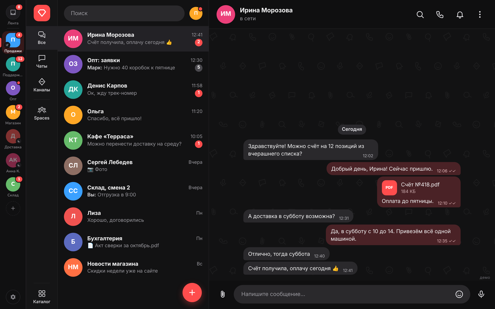
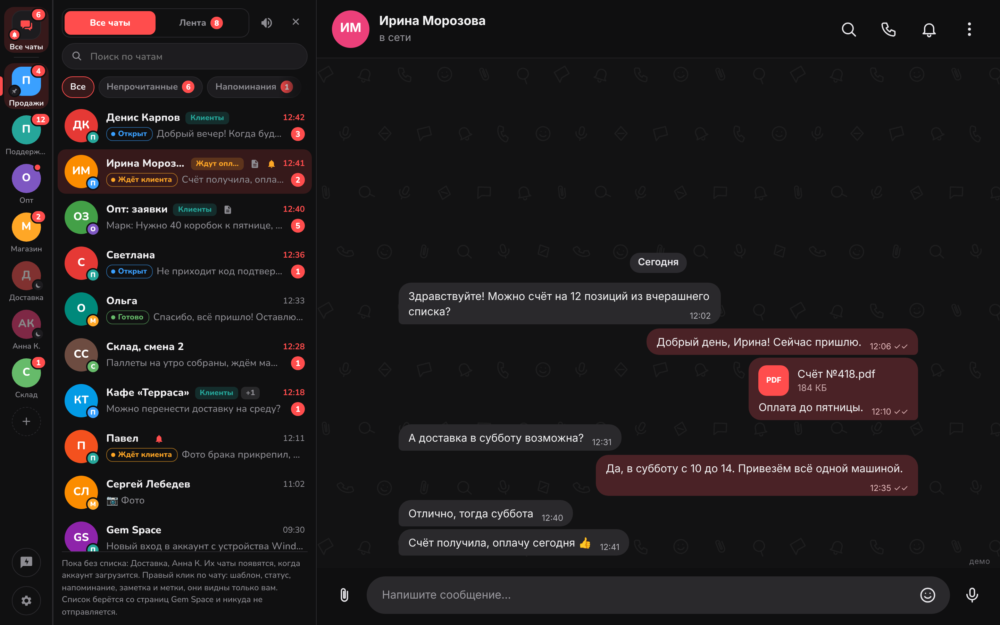
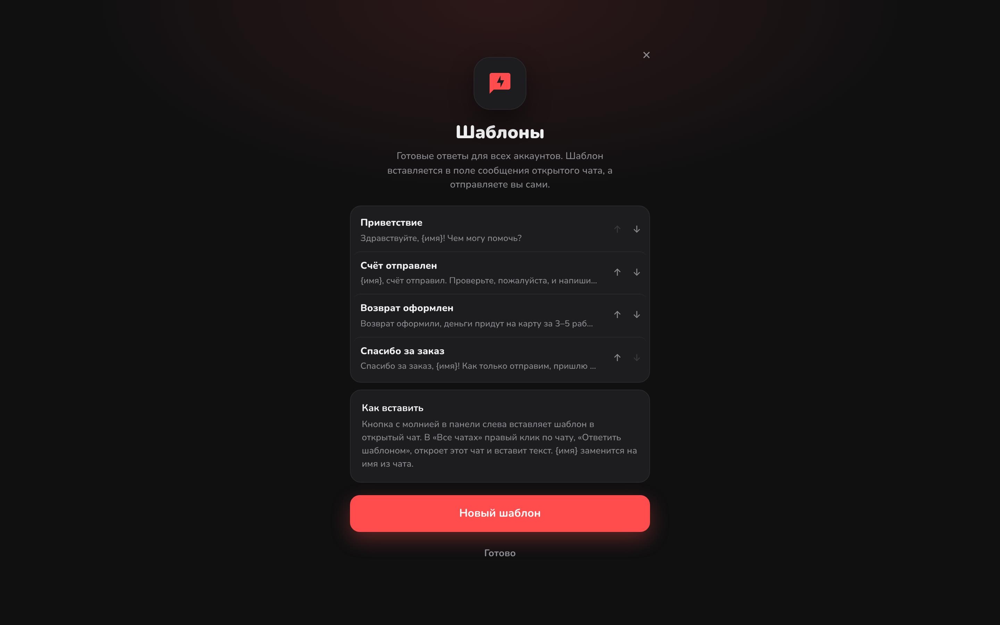

<h1 align="center">Hovi Space</h1>

<b>Все ваши аккаунты Gem Space в одном окне.</b> 
5, 10, 30 аккаунтов на Windows и Android: рейл аккаунтов, счётчики, уведомления с именем аккаунта, свой прокси на каждый и спящий режим.

<a href="#скачать"><b>Скачать: Windows, Android</b></a>

## Скачать

| | Что | Файл |
|---|---|---|
| **Windows** | Windows 10/11 | [Gemspace-setup.exe](https://github.com/chvdbhcx-del/gemspaceallinone/releases/latest/download/Gemspace-setup.exe) |
| **Android** | Android 8+ | [Gemspace.apk](https://github.com/chvdbhcx-del/gemspaceallinone/releases/latest/download/Gemspace.apk) |

Ссылки всегда ведут на самую свежую сборку. Все сборки: [релизы](https://github.com/chvdbhcx-del/gemspaceallinone/releases).

- **Windows:** если SmartScreen ругается, нажмите «Подробнее» → «Выполнить в любом случае». Установка в папку пользователя, права администратора не нужны.
- **Android:** разрешите установку из неизвестных источников. Для нескольких аккаунтов нужен Android System WebView версии 128 или новее, он обновляется в Google Play. На старом WebView работает один аккаунт.

Скриншоты в демо-режиме, аккаунты и переписка выдуманные. Справа демо-копия веб-версии Gem Space с выдуманными чатами: в приложении на этом месте открывается настоящая веб-версия. ПК: окно 1440×900. Телефон: экран 390×844. Снимает их `node docs/make-screens.js`, сетки собирает `python3 docs/make-grids.py`.

## Кому это нужно

Тем, кто ведёт несколько аккаунтов Gem Space сразу: продажи и поддержка, магазины, агентства, менеджеры сообществ. Вместо нескольких браузеров, телефонов и постоянных выходов и входов одно приложение, где все аккаунты рядом и каждый уже залогинен.

Внутри открывается обычная веб-версия Gem Space, [web.gemspace.com](https://web.gemspace.com/), со всеми её чатами, файлами и звонками. Hovi Space её не изменяет и не разбирает: он держит несколько её копий рядом, у каждой своё отдельное хранилище.

## Мультиаккаунт: как это работает

### Рейл аккаунтов

Слева полоса со всеми аккаунтами (на Android сверху): цветной кружок с инициалами, подпись и счётчик непрочитанных. Клик переключает аккаунт мгновенно, без перезагрузки и повторного входа. На Windows `Ctrl+1…9` открывает аккаунт по номеру, `Ctrl+Tab` и `Ctrl+Shift+Tab` листают аккаунты по кругу.

Правый клик по аккаунту (на Android долгое нажатие): изменить название, цвет и прокси, перезагрузить, усыпить, «Не усыплять», поменять порядок, удалить.

### Все чаты

Чаты всех аккаунтов одним списком, как в одном мессенджере: свежие сверху, со счётчиками непрочитанных. У каждой аватарки цветная метка аккаунта, чей это чат. Сверху поиск и фильтры «Все», «Непрочитанные» и по аккаунтам. Клик открывает чат в его аккаунте.

На Windows кнопка «Все чаты» стоит над аккаунтами, список встаёт колонкой рядом с рейлом, а чат открывается справа, так что можно идти по списку, не закрывая его. На Android это первая кнопка в полосе аккаунтов: список открывается на весь экран, нажатие открывает чат, «Назад» возвращает к списку.

Список берётся из того, что показывает страница Gem Space в каждом аккаунте: Hovi Space только читает строки списка чатов (название, время, начало последнего сообщения, счётчик, аватарка) и никуда их не отправляет ([shared/chats.js](shared/chats.js)). Поэтому в нём те чаты, что загрузила сама страница (обычно несколько десятков последних), а у спящего аккаунта показан последний известный список. Если Gem Space поменяет вёрстку, список просто перестанет обновляться, остальное продолжит работать.

### Метки

Чатам в «Все чаты» можно ставить свои метки: «Клиенты», «Ждут оплату» и любые другие, со своим цветом. На Windows правый клик по чату, «Метки», на Android долгое нажатие. Метка видна в строке чата, а по меткам можно отфильтровать список. Метки хранятся только у вас и в Gem Space не попадают.

### Статусы, заметки и напоминания

Правый клик по чату в «Все чаты» (на Android долгое нажатие) открывает меню чата:

- **Статус.** У чата один статус: «Открыт», «Ждёт клиента», «Готово» или свой, со своим цветом. Он виден в строке чата, по статусам можно отфильтровать список. Статусы можно переименовать и удалить (правый клик по фильтру статуса).
- **Напомнить.** Через 1 или 3 часа, завтра в 9:00, в понедельник в 9:00 или в выбранное время. В это время приходит уведомление «Напоминание · аккаунт» с названием чата и заметкой, а у чата загорается колокольчик. Фильтр «Напоминания» показывает такие чаты, ближайшие сверху. Напоминание снимается, когда вы открываете этот чат из списка. Hovi Space должен быть запущен (можно в трее или фоном на Android).
- **Заметка.** Несколько строк о собеседнике: «оптовик, скидка 10%», «звонить после 15:00». Видна значком в строке и подсказкой, поиск по списку ищет и в заметках.

Всё это хранится только у вас и в Gem Space не попадает.

### Шаблоны

Готовые ответы для всех аккаунтов: «Приветствие», «Счёт отправлен» и любые свои. Кнопка с молнией в панели (на Android «Шаблоны» сверху) вставляет выбранный шаблон в поле сообщения открытого чата, а в «Все чатах» пункт «Ответить шаблоном» сначала открывает нужный чат. `{имя}` заменяется на имя из чата.

Шаблон только вставляется, отправляете его вы сами: можно поправить текст и нажать «Отправить» в Gem Space. Если чата не видно или в поле что-то мешает, Hovi Space скажет, что не вставил. Для начала можно добавить три примера и поправить их под себя.

### Резервная копия

В настройках «Сохранить в файл» записывает аккаунты (названия, цвета, прокси, порядок, «Не усыплять»), настройки, метки, статусы, заметки, напоминания и шаблоны в файл JSON, «Восстановить из файла» возвращает их, в том числе на новом компьютере или телефоне. Входы в аккаунты в файл не попадают: после восстановления на новом устройстве в каждый аккаунт нужно войти по номеру телефона. Файл с Windows подходит для Android и наоборот, только настройки переносятся между одинаковыми устройствами, а прокси на Android не используются.

### Рассылка

Кнопка с рупором над «Все чатами» (на Android чип «Рассылка»): пишете текст, выбираете чаты по меткам или галочками и запускаете. Hovi Space по очереди открывает каждый чат, вставляет текст и нажимает «Отправить», как это сделал бы человек. `{имя}` в тексте заменяется на имя из чата.

- Только в чаты, которые уже есть в ваших аккаунтах, новым контактам ничего не уходит.
- Между сообщениями случайная пауза (по умолчанию 25–70 секунд, не меньше 10) и лимит в день на аккаунт (по умолчанию 50).
- Сверху виден ход: сколько отправлено, когда следующее, кнопка «Стоп». Чат с черновиком в поле пропускается, после трёх ошибок подряд рассылка останавливается.

**Риск:** [условия Gem Space](https://gemspace.com/terms-of-use) (п. 6.3) запрещают автосообщения и массовые рассылки, за это могут заблокировать аккаунт. Перед первой рассылкой Hovi Space предупреждает об этом. Пишите тем, кто ждёт ваших сообщений, и не ставьте маленькие паузы.

### Лента

Вторая вкладка «Все чаты»: новые сообщения всех аккаунтов, сверху самые свежие: аккаунт, от кого и текст. Клик открывает этот аккаунт и сам чат, ответ пишется там, в Gem Space. Из ленты ничего не отправляется.

Лента собирается из уведомлений, которые аккаунты присылают, пока Hovi Space запущен. Поэтому в ней нет спящих аккаунтов (отметьте важные «Не усыплять») и сообщений, пришедших до запуска. Когда в аккаунте всё прочитано, его сообщения уходят из ленты. Можно очистить ленту и кнопкой.

### Аккаунты не мешают друг другу

У каждого аккаунта свой профиль браузера: свои cookies, хранилище и вход. Аккаунты не видят данных друг друга, как будто это разные браузеры. Вход как обычно, по номеру телефона.

На Windows для каждого аккаунта можно задать свой SOCKS5 или HTTP-прокси, и такой аккаунт выходит в сеть только через него. Прокси с логином и паролем WebView2 не поддерживает, нужен прокси без авторизации или по IP.

### Уведомления со всех аккаунтов

Новое сообщение приходит уведомлением Windows или Android с именем аккаунта: «Поддержка · Ирина». Уведомления приходят и от аккаунтов, которые сейчас не открыты. Аккаунт с новым сообщением отмечается точкой в рейле. На Android нажатие на уведомление открывает нужный аккаунт. Текст сообщения в уведомлениях можно скрыть.

### Счётчики

У каждого аккаунта свой счётчик непрочитанных, а общая сумма видна в заголовке окна и в подсказке значка в трее (Windows) или в шторке (Android).

### Спящий режим

Каждый открытый аккаунт занимает память. Hovi Space держит загруженными только последние открытые аккаунты (8 на Windows, 4 на Android, число настраивается), а остальные выгружает. Спящий аккаунт показан бледным с луной и просыпается по клику, уже залогиненным.

- Открытый аккаунт и отмеченные «Не усыплять» не засыпают никогда.
- Спящий аккаунт не присылает уведомлений, пока его не открыть. Важные аккаунты отметьте «Не усыплять».
- Режим можно выключить совсем.

### Работа в фоне

- **Windows:** крестик сворачивает Hovi Space в трей, уведомления продолжают приходить. Выйти совсем можно из меню значка в трее. Второй запуск просто открывает уже запущенное окно.
- **Android:** значок «Hovi Space на связи» в шторке не даёт системе выгрузить приложение, и аккаунты остаются на связи. Его можно выключить в настройках.

### Обновления

Hovi Space обновляется сам из [релизов](https://github.com/chvdbhcx-del/gemspaceallinone/releases) этого репозитория.

- **Windows:** новые версии проверяются при запуске и раз в несколько часов. Когда выходит новая, над шестерёнкой появляется синяя кнопка. По клику Hovi Space скачивает установщик, проверяет его подпись, ставит и перезапускается. Обновление без подписи ключом Hovi Space не установится.
- **Android:** при запуске Hovi Space предлагает новую версию, её можно проверить и вручную в настройках («Обновления»). APK скачивается, и Android предлагает установить его поверх. Android сам проверяет, что APK подписан тем же ключом.

Аккаунты и входы при обновлении сохраняются. Версии, вышедшие до появления обновлений, нужно один раз поставить вручную.

### Звонки, файлы, ссылки

Микрофон и камера разрешаются для звонков. Ссылки из чатов открываются в обычном браузере, а не внутри аккаунта. Файлы скачиваются в «Загрузки». На Windows `Ctrl+колесо` меняет масштаб.

## Чего нет и почему

У Gem Space нет открытого клиента и публичного API, поэтому «Все чаты» знают только то, что видно в списке чатов страницы, а рассылка работает через саму страницу, как человек. Отложенных и повторяющихся по расписанию рассылок нет. Модифицировать приложения Gem Space запрещает п. 5.1, поэтому Hovi Space их и не трогает.

## Приватность

- Hovi Space никуда не отправляет ваши данные. Сообщения идут напрямую между веб-версией Gem Space и серверами Gem Space.
- Перед страницей Gem Space Hovi Space добавляет только небольшой скрипт ([Windows](desktop/src/inject.js), [Android](android/app/src/main/assets/inject.js)). Он перенаправляет уведомления страницы в уведомления системы и в ленту, ловит горячие клавиши и читает список чатов для «Все чаты» ([shared/chats.js](shared/chats.js)). Пишет и отправляет он только в рассылке, которую вы запустили сами, а шаблон только вставляет в поле сообщения, без отправки. Лента и списки чатов хранятся только в памяти и пропадают при выходе из Hovi Space.
- На Windows странице Gem Space доступны только команды приложения: показать уведомление, горячие клавиши, передать список чатов и результат сообщения рассылки ([capabilities/accounts.json](desktop/capabilities/accounts.json)).
- Удаление аккаунта в Hovi Space стирает его данные на устройстве. Сам аккаунт Gem Space остаётся, войти в него можно снова.

## Сборка

Всё собирает GitHub Actions ([build.yml](.github/workflows/build.yml)). На каждый PR идёт проверочная сборка, а на каждый пуш в `main` выходит релиз с `Gemspace-setup.exe` и `Gemspace.apk`.

| Папка | Что |
|---|---|
| `desktop/` | Windows: Tauri 2 (Rust). Одно окно, рейл `ui/` и по WebView2 с отдельной папкой данных на аккаунт |
| `android/` | Android: Kotlin. По WebView с отдельным профилем (`androidx.webkit` Profile) на аккаунт |
| `docs/` | скриншоты и демо-режим для них (`node docs/make-screens.js`, сетки `python3 docs/make-grids.py`) |

Локально: `cd desktop && npx @tauri-apps/cli@2 build` (Windows) и `cd android && ./gradlew assembleRelease`.

### Ключ подписи APK

Android ставит обновление поверх старой версии, только если оба APK подписаны одним ключом. Ключ берётся из секретов в Settings → Secrets and variables → Actions:

| Секрет | Что |
|---|---|
| `ANDROID_KEYSTORE_BASE64` | файл ключа `.jks` в base64 (`base64 -w0 gemspace.jks`) |
| `ANDROID_KEYSTORE_PASSWORD` | пароль ключа (алиас `gemspace`) |

Без них APK подписывается временным ключом, и каждую новую сборку придётся ставить заново, удалив старую.

### Ключ обновлений Windows

Установщик для обновлений подписывается ключом Tauri updater. Его открытая часть лежит в `desktop/tauri.conf.json` (`plugins.updater.pubkey`), закрытая в секретах:

| Секрет | Что |
|---|---|
| `TAURI_SIGNING_PRIVATE_KEY` | закрытый ключ (`npx @tauri-apps/cli signer generate`) |
| `TAURI_SIGNING_PRIVATE_KEY_PASSWORD` | его пароль |

Без них сборка проходит, но релиз выходит без `latest.json`, и приложения на Windows его не видят.

## Лицензия

MIT. Gem Space является товарным знаком своих владельцев, Hovi Space с ними не связан.
